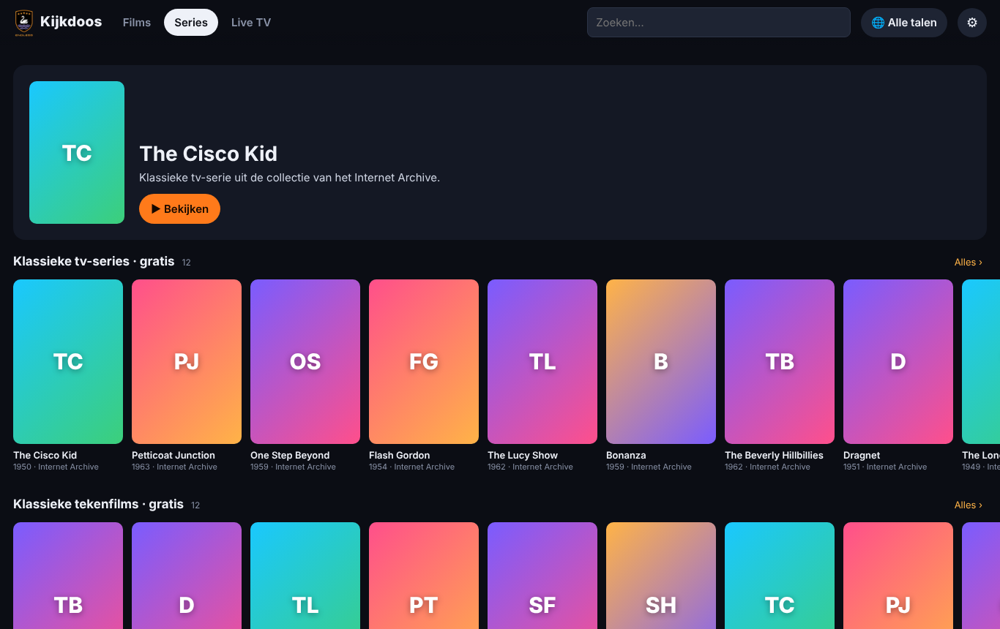
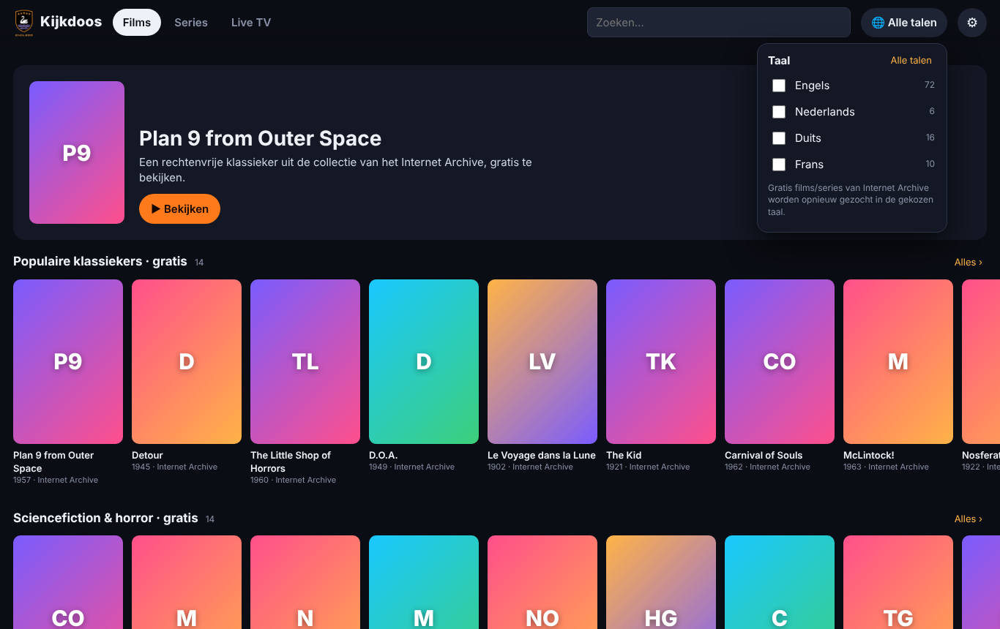
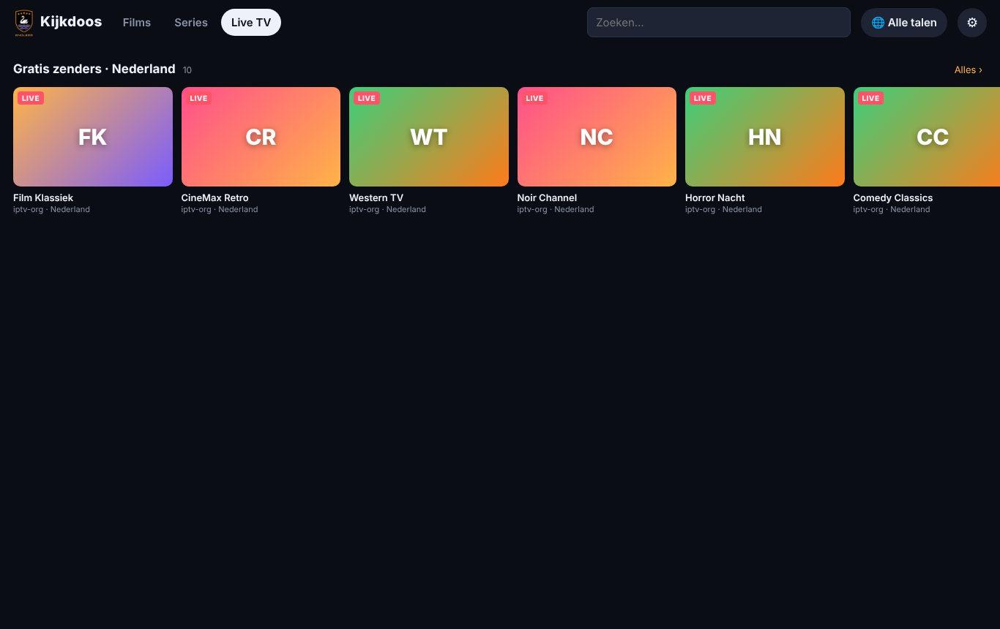
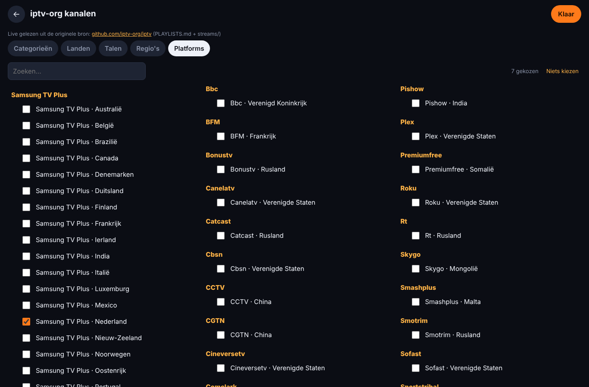
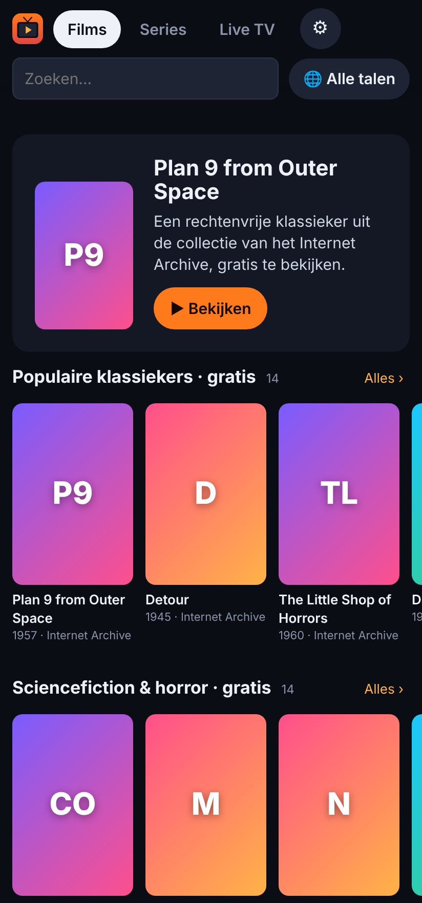

# 📺 Kijkdoos — IPTV voor Android, Windows en web

Gratis films, series en live tv op één plek, plus je eigen IPTV-abonnementen.
Standaard laadt Kijkdoos alleen de actuele index (snel, niets bewaard). Zet *Streams controleren* aan (⚙) om alleen te testen wat in beeld is — wat niet werkt verdwijnt dan.

**Web-versie:** https://endless1977.github.io/IpTv/
**Downloads (Android .apk / Windows .exe):** [Releases → latest](https://github.com/Endless1977/IpTv/releases/latest)

## Wat zit erin
- **Films** en **Series** (en **Live TV** zodra er zenders zijn), Netflix-achtige rijen met thumbnails
- **Gratis bronnen:**
  - Internet Archive — duizenden rechtenvrije speelfilms, tv-series en tekenfilms (on demand)
  - [iptv-org/iptv](https://github.com/iptv-org/iptv) — rechtstreeks uit de originele repo. Kies via ⚙ → *Kanalen kiezen…* uit alle
    categorieën, talen, landen (incl. provincies/steden), regio's en de bronbestanden per platform (Samsung TV Plus, Pluto TV, Rakuten, …).
    De catalogus wordt live gelezen uit `PLAYLISTS.md` en `streams/` van iptv-org; `www/iptv-catalog-data.js` is alleen een reservekopie
    (bijwerken: `node scripts/build-iptv-catalog.js <pad-naar-iptv-org/iptv>`).
- **Abonnementen:** Xtream Codes (server + gebruikersnaam + wachtwoord) of een M3U-link.
  Films, series (met seizoenen/afleveringen) en zenders worden automatisch ingedeeld.
  Een verlopen of niet-werkend abonnement toont niets.
- **Hele categorie:** tik op een rijtitel of *Alles ›* — de complete categorie wordt geladen (ook duizenden titels).
- **Sorteren:** populair, titel A→Z / Z→A, jaar nieuw/oud, sterren hoog/laag, Rotten Tomatoes, laatst toegevoegd.
- **Filters:** zoeken binnen de categorie, decennium, minimale beoordeling, genre (+ het taalfilter).
- **Beoordelingen:** sterren van Internet Archive en je provider; Rotten Tomatoes en IMDb via een gratis [OMDb-sleutel](https://www.omdbapi.com/apikey.aspx).
- **Cache naar keuze:** uit = alles realtime; aan = index, beschikbaarheid en beoordelingen 1 uur – 7 dagen bewaren.
- **Realtime controle (aan/uit):** alleen kaarten die in beeld zijn worden getest; geen voorladen en geen cache op het apparaat.
- **Taalfilter** (🌐): kies één of meer talen; ook abonnementen worden herkend aan labels als `NL |`, `[DE]`, `UK:`
- **Externe speler:** speel af in VLC, MX Player, Just Player, mpv, Kodi of TiviMate (Android) of in VLC, mpv, MPC-HC/BE, PotPlayer of elk ander programma (Windows). Kies per titel “↗” of zet *Altijd extern afspelen* aan.
- Zoeken, detailpagina's, automatisch volgende aflevering, "Kopieer link".

## Screenshots
| Films | Series |
|---|---|
|  |  |
| **Detail met afleveringen** | **Taalfilter** |
|  |  |
| **Live TV** | **Abonnementen & externe speler** |
|  |  |
| **iptv-org kanaalkiezer** | |
|  | |

*Screenshots gemaakt met voorbeelddata; zonder poster toont Kijkdoos een gekleurde placeholder, met poster de echte afbeelding.*

## Installeren
| Platform | Hoe |
|---|---|
| Android | Download `Kijkdoos.apk` uit Releases en installeer (onbekende bronnen toestaan) |
| Windows | `Kijkdoos-Setup-x.exe` of de portable `.exe` uit Releases |
| Beide (lichtgewicht) | Open de web-versie in Chrome/Edge → *Installeren* / *Toevoegen aan startscherm* |

De Android- en Windows-app hebben geen browserbeperkingen (CORS, http-streams) en tonen dus meer zenders dan de web-versie.

## Web-versie met proxy (optioneel)
Veel IPTV-servers blokkeren browsers. Draai `python3 proxy.py` (bijv. op een Raspberry Pi) en
open `http://<pi-ip>:8090/`, of vul `http://<pi-ip>:8090/proxy?url=` in bij ⚙ → CORS-proxy.

## Zelf bouwen
Elke push naar `main` bouwt via GitHub Actions automatisch de web-versie (Pages), de APK en de EXE.
Lokaal: `npm install && npm start` (Windows-app) of `npx cap add android && npx cap sync && npx cap open android`.

> Kijkdoos levert zelf geen content; het speelt openbare gratis streams en jouw eigen abonnementen af.
