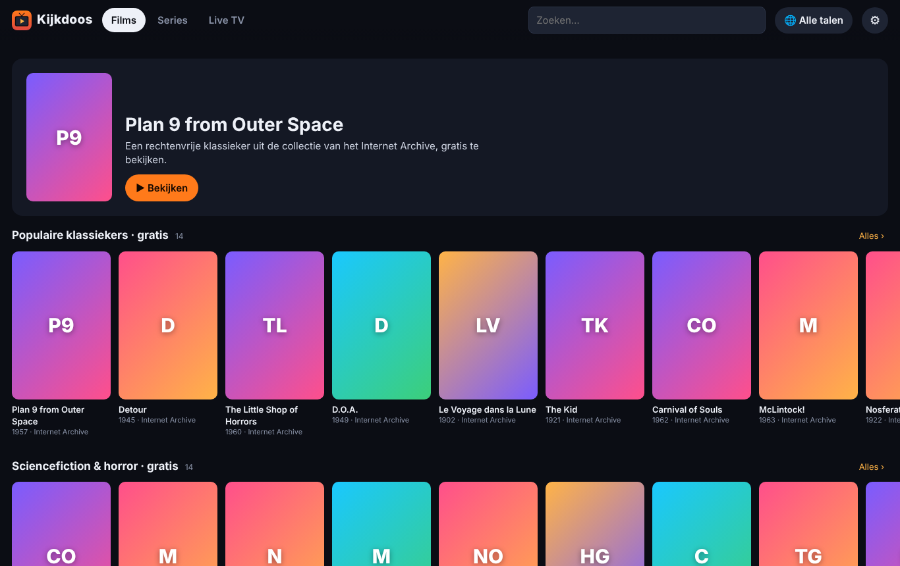
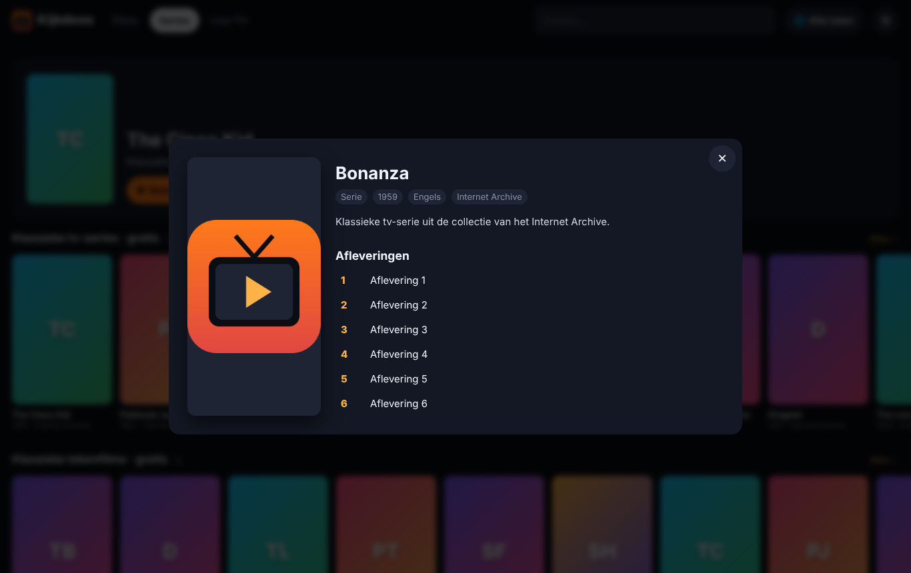
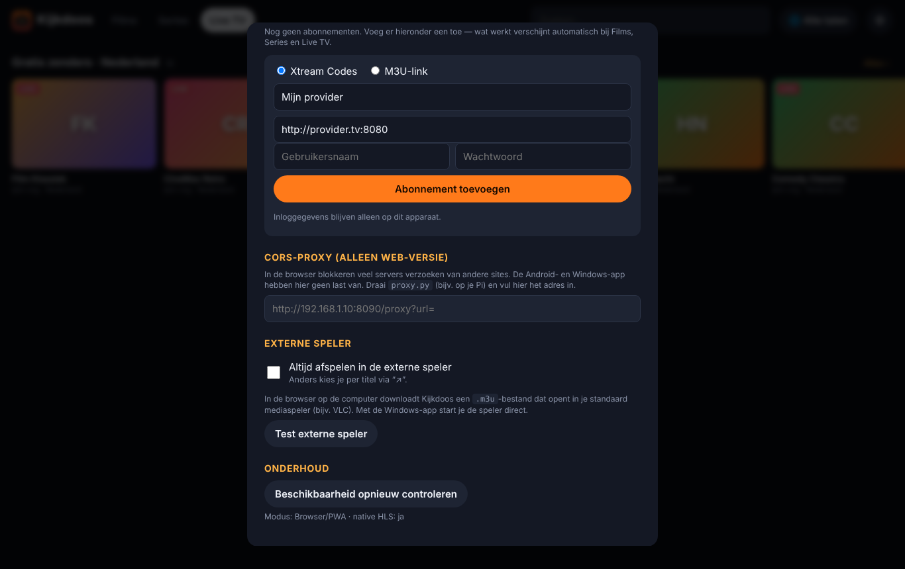

# 📺 Kijkdoos — IPTV voor Android, Windows en web

Gratis films, series en live tv op één plek, plus je eigen IPTV-abonnementen.
Alleen streams die echt werken worden getoond; de rest blijft verborgen (aan te zetten via ⚙).

**Web-versie:** https://endless1977.github.io/IpTv/
**Downloads (Android .apk / Windows .exe):** [Releases → latest](https://github.com/Endless1977/IpTv/releases/latest)

## Wat zit erin
- **Films** en **Series** (en **Live TV** zodra er zenders zijn), Netflix-achtige rijen met thumbnails
- **Gratis bronnen:**
  - Internet Archive — duizenden rechtenvrije speelfilms, tv-series en tekenfilms (on demand)
  - iptv-org — openbaar beschikbare film-, serie-, klassieke en animatiekanalen + Nederlandse zenders
- **Abonnementen:** Xtream Codes (server + gebruikersnaam + wachtwoord) of een M3U-link.
  Films, series (met seizoenen/afleveringen) en zenders worden automatisch ingedeeld.
  Een verlopen of niet-werkend abonnement toont niets.
- **Beschikbaarheidscheck:** elke stream wordt op de achtergrond getest; resultaten worden 6 uur onthouden.
- **Taalfilter** (🌐): kies één of meer talen; ook abonnementen worden herkend aan labels als `NL |`, `[DE]`, `UK:`
- **Externe speler:** speel af in VLC, MX Player, Just Player, mpv, Kodi of TiviMate (Android) of in VLC, mpv, MPC-HC/BE, PotPlayer of elk ander programma (Windows). Kies per titel “↗” of zet *Altijd extern afspelen* aan.
- Zoeken, detailpagina's, automatisch volgende aflevering, "Kopieer link".

## Screenshots
| Films | Series |
|---|---|
|  |  |
| **Detail met afleveringen** | **Taalfilter** |
|  |  |
| **Live TV** | **Abonnementen & externe speler** |
|  |  |

*Screenshots gemaakt met voorbeelddata; zonder poster toont Kijkdoos een gekleurde placeholder, met poster de echte afbeelding.*

## Installeren
| Platform | Hoe |
|---|---|
| Android | Download `Kijkdoos.apk` uit Releases en installeer (onbekende bronnen toestaan) |
| Windows | `Kijkdoos-Setup-x.exe` of de portable `.exe` uit Releases |
| Beide (lichtgewicht) | Open de web-versie in Chrome/Edge → *Installeren* / *Toevoegen aan startscherm* |

De Android- en Windows-app hebben geen browserbeperkingen (CORS, http-streams) en tonen dus meer zenders dan de web-versie.

## Web-versie met proxy (optioneel)
Veel IPTV-servers blokkeren browsers. Draai `python3 proxy.py` (bijv. op een Raspberry Pi) en
open `http://<pi-ip>:8090/`, of vul `http://<pi-ip>:8090/proxy?url=` in bij ⚙ → CORS-proxy.

## Zelf bouwen
Elke push naar `main` bouwt via GitHub Actions automatisch de web-versie (Pages), de APK en de EXE.
Lokaal: `npm install && npm start` (Windows-app) of `npx cap add android && npx cap sync && npx cap open android`.

> Kijkdoos levert zelf geen content; het speelt openbare gratis streams en jouw eigen abonnementen af.
